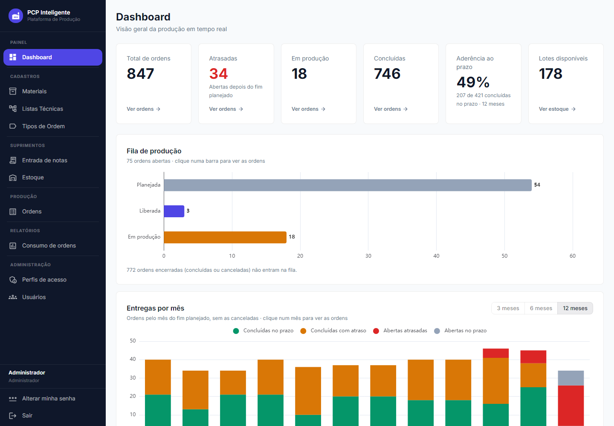
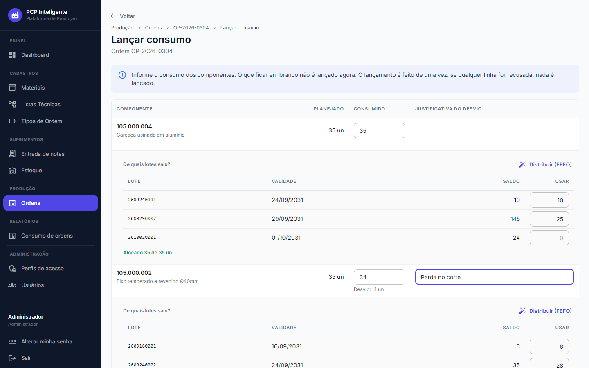
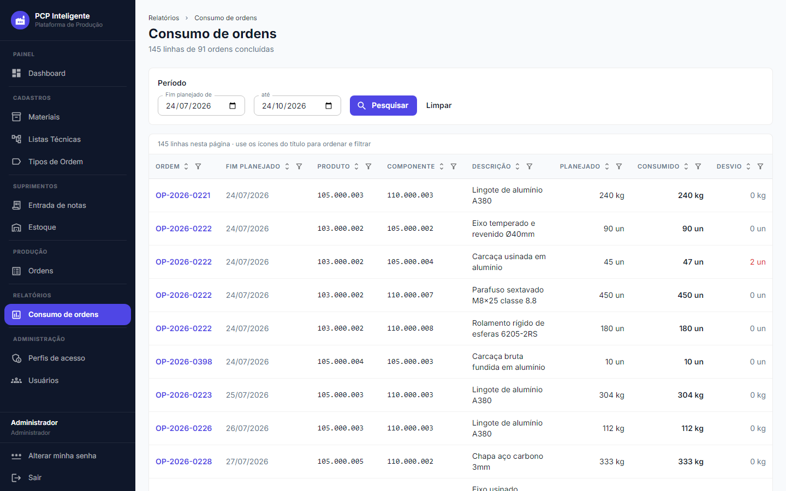
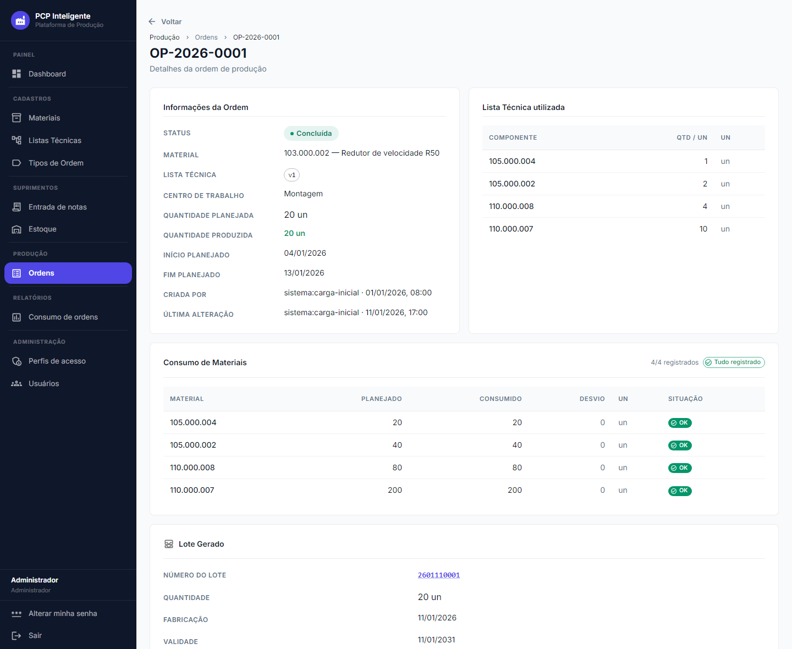
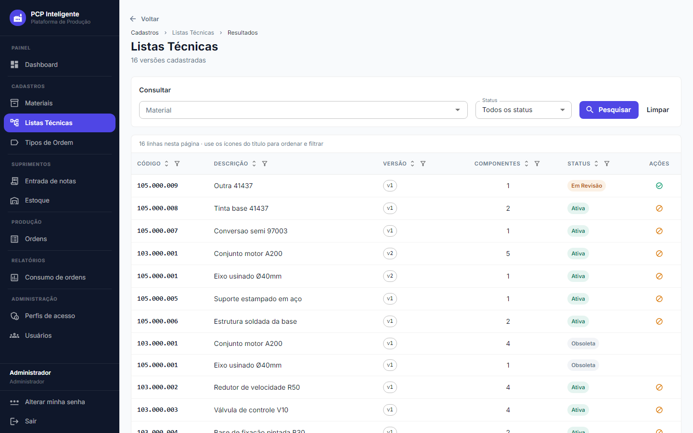
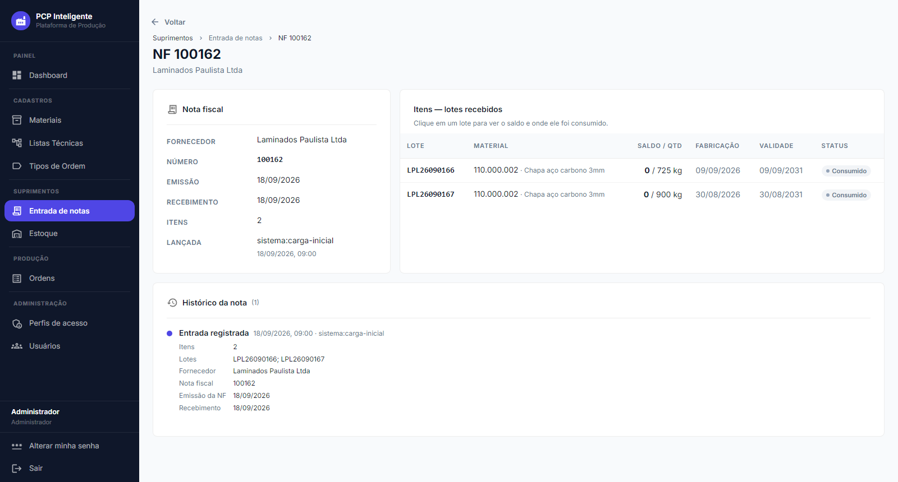
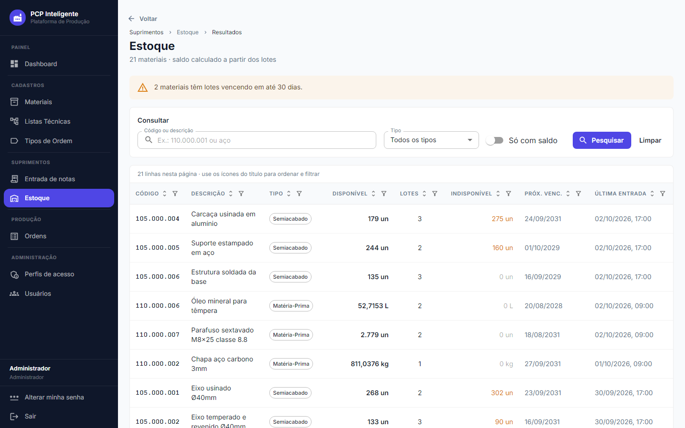
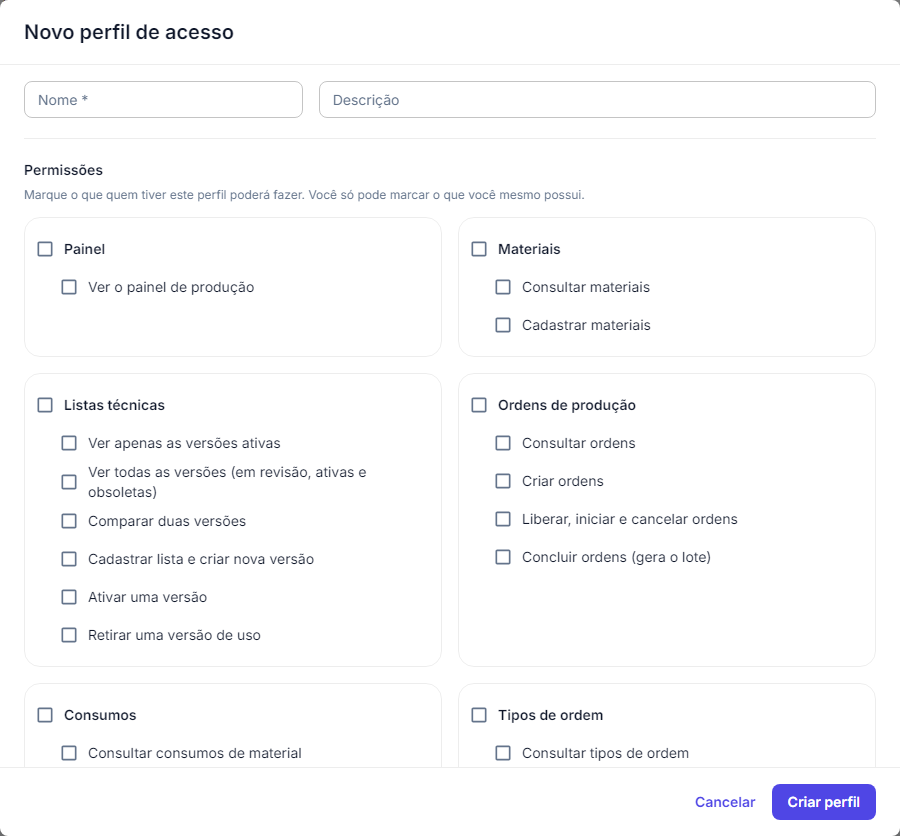
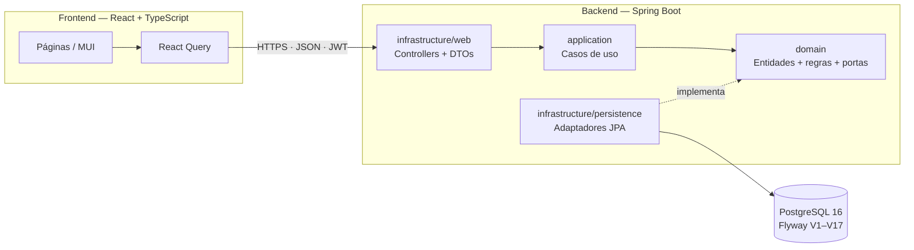
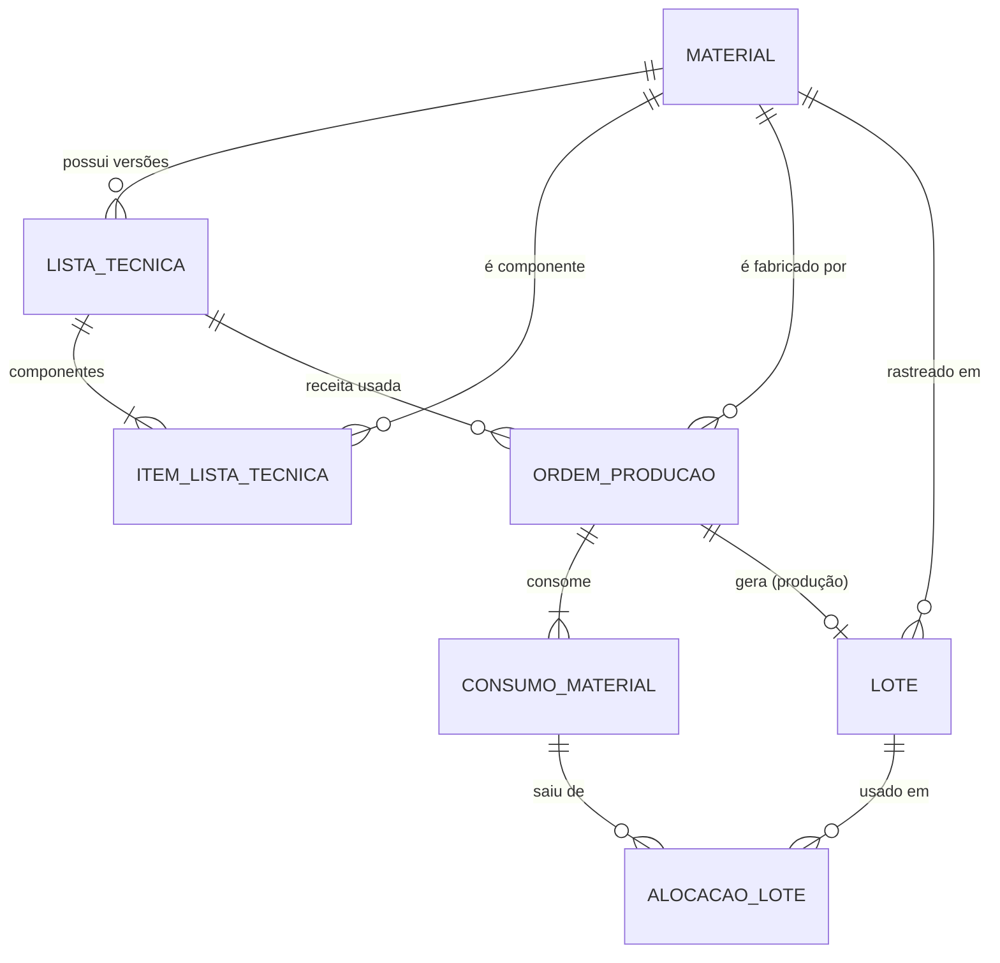

<div align="center">

# 🏭 PCP Inteligente

**Plataforma de Planejamento e Controle da Produção com rastreabilidade de ponta a ponta**

Do recebimento da matéria-prima ao lote do produto acabado — com lista técnica versionada,
consumo real × planejado e base de dados preparada para análise com IA.

[](https://github.com/Krsoliveira/pcp-inteligente-producao/actions/workflows/ci.yml)




</div>

---

## Sobre o projeto

Times de **PCP (Planejamento e Controle da Produção)** decidem *o que* produzir, *quanto*,
*quando* e *com quais recursos* — e, na prática, fazem isso com planilhas desconectadas e
pouca visibilidade de atrasos e perdas.

Este projeto modela o núcleo desse processo como um sistema real faria: materiais e
**listas técnicas (BOM) versionadas**, ordens de produção com **máquina de estados**,
**consumo de material com desvio justificado** e **lotes rastreáveis** — da nota fiscal do
fornecedor até o lote do produto acabado. É a base de dados sobre a qual o módulo de IA
(previsão de demanda e análise de atrasos) está sendo construído.

> Projeto de portfólio que une experiência em PCP, auditoria e engenharia de software.

## Destaques técnicos

| | |
|---|---|
| 🧱 **Clean Architecture + DDD** | Domínio em Java puro (sem Spring/JPA), portas e adaptadores, casos de uso explícitos. Regras de negócio vivem nas entidades — é impossível levar uma ordem a um estado inválido. |
| 🔁 **Regras de negócio reais** | BOM multinível com várias versões em uso e quantidade base (receita "por 100 kg"), conclusão de ordem bloqueada sem consumos registrados e justificados, produto acabado só consumido em ordem de **Conversão**, lançamento de consumo **tudo ou nada** numa transação, lote com origem única (produção **ou** compra) garantida no banco. |
| 🔎 **Auditoria** | Todo registro assinado (quem criou/alterou e quando) e trilha de eventos **imutável** — um trigger no PostgreSQL bloqueia `UPDATE`, `DELETE` e `TRUNCATE`. Ação e evento gravados na mesma transação. |
| 🔐 **Segurança** | JWT stateless + BCrypt; **controle de acesso por perfis e permissões** (o servidor confere cada requisição; "só se concede o que se tem"); troca de senha obrigatória no primeiro acesso; autocadastro nunca concede privilégio; rate limiting por IP, limite de corpo e CORS restrito; credenciais do administrador só em variáveis de ambiente; erros no padrão RFC 9457. |
| 🧪 **Qualidade** | Quase 900 testes automáticos: backend com unidade + integração com **Testcontainers** (PostgreSQL real, mais de 540) e frontend com **Vitest + Testing Library** (mais de 350). Um teste carrega o dataset inteiro e valida as invariantes do domínio; outro força a falha na última linha de um lançamento e prova que nada foi gravado. |
| 🛡️ **DevSecOps** | CI com CodeQL, Semgrep, Gitleaks, Trivy, OWASP Dependency-Check (job próprio) e `npm audit`; Dependabot semanal. |
| 📊 **Engenharia de dados** | Gerador Python determinístico (pipeline load → transform → validate → export) com sazonalidade, gargalos e desvios — sinal real para a IA. Datas ancoradas no dia da carga. |
| 📝 **Decisões documentadas** | [27 ADRs](docs/README.md#índice-de-adrs) registram o *porquê* de cada escolha de arquitetura. |

## Funcionalidades

- **Materiais** — produto acabado, semiacabado e matéria-prima, com código de 9 dígitos gerado na faixa do tipo (`103.000.001`, `105…`, `110…`).
- **Listas técnicas (BOM)** — várias versões em uso por material, com escolha da versão ao criar a ordem,
  comparação entre versões (por unidade produzida) e cópia de uma versão para criar a próxima. Cada versão
  tem a sua **quantidade base**: "80 kg de pigmento para 100 kg de tinta" é escrito assim, sem frações.
- **Ordens de produção** — ciclo `Planejada → Liberada → Em produção → Concluída`, com
  consumo projetado automaticamente a partir da BOM (item ÷ base × quantidade da ordem). Produto acabado
  nunca é componente de outro acabado: só pode ser consumido numa ordem do tipo **Conversão**, que gera semiacabado.
- **Lançamento de consumo** — uma tela por ordem com todos os componentes, os lotes de onde cada um saiu
  (sugestão FEFO) e a justificativa de cada desvio. Tudo é gravado de uma vez: se uma linha for recusada,
  nada é lançado. Item fora da lista entra com justificativa e permissão própria.
- **Consumo de materiais** — planejado × consumido; todo desvio exige justificativa, registrada em nome do usuário logado.
- **Entrada de notas** — nota fiscal de compra com vários itens; cada item vira um lote de
  matéria-prima com o lote do fornecedor. A mesma nota ou o mesmo lote não entram duas vezes.
- **Estoque** — posição por material calculada a partir dos lotes (disponível, indisponível,
  próximo vencimento), com os lotes de cada material e alerta de vencimento.
- **Lotes rastreáveis** — de compra (lote do fornecedor, ligado à nota) ou de produção
  (`AAMMDD` + sequência do dia, ex.: `2610030001`), com saldo e validade.
- **Genealogia de lotes** — todo consumo informa de quais lotes saiu (sugestão FEFO); do
  produto acabado chega-se à nota fiscal da matéria-prima e, do lote comprado, a todas as
  ordens e lotes que o usaram. Consumos simultâneos não ultrapassam o saldo (bloqueio de linha).
- **Rastreabilidade** — cada registro mostra quem criou, quem alterou e quando; a trilha de
  auditoria (`GET /api/v1/auditoria/eventos`) filtra por entidade, registro, usuário, ação e período.
- **Consulta nas listagens** — primeiro um filtro simples no banco (com período, onde faz sentido) e,
  nos resultados, filtro e ordenação por coluna no cabeçalho, como numa planilha; paginação "página X de Y".
- **Dashboard acionável** — cada número abre a lista de ordens que o originou; aderência ao prazo
  (pelo instante em que a ordem foi concluída no sistema), fila de produção, entregas por mês e atrasos
  por centro de trabalho.
- **Relatório de consumo de ordens** — por período do fim planejado: cada ordem concluída com seus
  componentes, planejado, consumido e desvio, com filtro e ordenação por coluna.
- **Controle de acesso** — cada usuário tem um perfil, e o perfil é um conjunto de permissões por área.
  O Administrador cria perfis e usuários; quem gerencia só concede o que ele mesmo tem; menus, telas e
  API respeitam as permissões. Quem se cadastra sozinho entra como Visualizador (só consulta).
- **Senhas** — o usuário criado por um gestor entra com senha provisória e é obrigado a trocá-la antes de
  usar o sistema; há "Alterar minha senha" no menu e "Redefinir senha" para o gestor. Nenhuma senha
  aparece na trilha de auditoria.

## Telas

<table>
  <tr>
    <td width="50%"><br><sub><b>Lançamento de consumo</b> — todos os componentes, lotes (FEFO) e desvio justificado, tudo ou nada</sub></td>
    <td width="50%"><br><sub><b>Relatório de consumo</b> — planejado × consumido por ordem e componente</sub></td>
  </tr>
  <tr>
    <td width="50%"><br><sub><b>Ordem de produção</b> — BOM utilizada, consumo e lote gerado</sub></td>
    <td width="50%"><br><sub><b>Listas técnicas</b> — versões em uso e obsoletas por material</sub></td>
  </tr>
  <tr>
    <td width="50%"><br><sub><b>Entrada de notas</b> — nota fiscal com vários itens; cada item vira um lote</sub></td>
    <td width="50%"><br><sub><b>Estoque</b> — saldo por material, com filtro e ordenação por coluna</sub></td>
  </tr>
  <tr>
    <td width="50%"><br><sub><b>Perfis de acesso</b> — permissões por área; só se marca o que se possui</sub></td>
    <td width="50%"></td>
  </tr>
</table>

## Arquitetura

A dependência aponta **sempre para dentro**: o domínio não conhece banco, web nem framework.



### Modelo de domínio



Detalhes em [docs/arquitetura.md](docs/arquitetura.md).

## Stack

| Camada | Tecnologias |
|---|---|
| **Backend** | Java 21, Spring Boot 3.5, Spring Security, JPA/Hibernate, Flyway, Bean Validation, springdoc-openapi (Swagger) |
| **Frontend** | React 19, TypeScript, Vite, Material UI 6, TanStack Query, Zustand, ECharts |
| **Dados** | PostgreSQL 16, gerador Python (biblioteca padrão) |
| **Testes** | JUnit 5, AssertJ, Testcontainers (backend); Vitest, Testing Library (frontend) |
| **DevOps** | Docker Compose, GitHub Actions, Dependabot |

## Como rodar

**Pré-requisitos:** Docker Desktop, JDK 21, Maven e Node.js 22.22+ ou 24.15+ (exigência do jsdom 30, usado nos testes).

```bash
# 1. Infraestrutura
cp .env.example .env
docker compose up -d

# 2. Backend — API em http://localhost:8080 · Swagger em /swagger-ui.html
#    Sem usuário não se entra: defina o administrador inicial (veja abaixo) antes de subir.
cd backend
mvn spring-boot:run -Dspring-boot.run.profiles=dev,seed   # "seed" carrega o dataset (só em banco vazio)

# 3. Frontend — http://localhost:3000
cd ../frontend
npm install
npm run dev
```

Entre com o administrador inicial. Quem usar **Criar conta** entra como Visualizador (só consulta) até um
gestor lhe dar outro perfil.

**Testes:** `cd backend && mvn -B verify` (requer Docker com o daemon rodando, por causa do Testcontainers) e
`cd frontend && npm run lint && npm test && npm run build`.

<details>
<summary><b>Usuário administrador inicial</b></summary>

A API cria um usuário com o perfil **Administrador** na inicialização a partir de variáveis de ambiente —
as credenciais nunca vão para o código nem para o Git. No PowerShell:

```powershell
$env:ADMIN_NOME  = "Seu Nome"
$env:ADMIN_EMAIL = "seu@email.com"
$env:ADMIN_SENHA = "uma-senha-forte"
mvn spring-boot:run "-Dspring-boot.run.profiles=dev,seed"
```

A senha deve ter no mínimo 8 caracteres; configuração incompleta impede a API de subir. O administrador
inicial não precisa trocar a senha, que vem do ambiente.

Idempotente: se o e-mail já existir, nada muda (nem a senha), e uma conta existente nunca é promovida.
Para **recuperar o acesso** quando o único Administrador esquece a senha, suba a API com um e-mail novo em
`ADMIN_EMAIL`: ela cria um segundo Administrador, que redefine a senha do primeiro pela tela de Usuários
(ver [ADR-0021](docs/adr/0021-troca-de-senha-no-primeiro-acesso.md)).
</details>

<details>
<summary><b>Portas e serviços locais</b></summary>

| Serviço | Endereço |
|---|---|
| API REST | <http://localhost:8080/api/v1> |
| Swagger UI | <http://localhost:8080/swagger-ui.html> (desligado em produção) |
| Frontend | <http://localhost:3000> |
| PostgreSQL | `localhost:5433` (host 5433 → container 5432) |

O `docker-compose.yml` também sobe Redis e RabbitMQ, reservados para as próximas fases.
</details>

## Estrutura

```
├── backend/     # Spring Boot — domain · application · infrastructure
├── frontend/    # React + TypeScript
├── data/        # Gerador do dataset sintético (Python)
├── docs/        # Visão, arquitetura, glossário, ADRs e imagens
└── .github/     # CI (build, testes e segurança) e Dependabot
```

## Roadmap

| Fase | Entrega | Status |
|---|---|---|
| 0–4 | Fundação, API de ordens, autenticação JWT, dashboard, carga de dados | ✅ |
| 5a | Material + lista técnica (BOM) versionada | ✅ |
| 5b | Consumo de material, lotes, conclusão de ordem, dataset sintético, entrada de matéria-prima | ✅ |
| 5b+ | Rastreabilidade (auditoria e genealogia de lotes) e suprimentos (entrada de notas e estoque) | ✅ |
| 5b++ | Consulta em duas etapas, filtro e ordenação por coluna, versões de lista técnica, controle de acesso por perfis e troca de senha | ✅ |
| 5b+++ | Dashboard acionável, relatório de consumo, ordem de Conversão, lançamento de consumo por ordem e quantidade base da lista | ✅ |
| 5c | **Interface** — visual com sombras e brilho (neon) | 🔜 |
| 5d | **Módulo de IA** — previsão de demanda, análise de atrasos e recomendações | 🔜 |
| 6 | **Qualidade** — inspeção do lote após a produção (plano, laudo, aprovação ou reprova) | 🔜 |
| 7 | Integrações simuladas (SAP, Power BI) e deploy no Railway ([ADR-0013](docs/adr/0013-deploy-railway.md)) | 🔜 |

Planejado para as próximas fases: cache com Redis e eventos com RabbitMQ (já provisionados no Docker
Compose, ainda sem consumidores). Estado detalhado em [docs/proximos-passos.md](docs/proximos-passos.md).

## Documentação

- [Visão geral](docs/visao-geral.md) — problema, escopo e personas
- [Arquitetura](docs/arquitetura.md) — camadas, fluxos e convenções
- [Glossário](docs/glossario.md) — termos de PCP e técnicos
- [ADRs](docs/README.md#índice-de-adrs) — registro das decisões de arquitetura
- [Dados](data/README.md) — como o dataset sintético é gerado

---

<div align="center">
Desenvolvido por <a href="https://github.com/Krsoliveira">@Krsoliveira</a>
</div>
